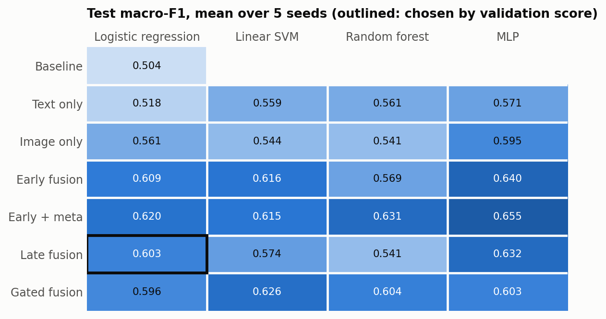

# Multimodal Sentiment Analysis on MVSA-Single

BITS F464 Machine Learning project.

This project classifies Twitter text-image posts as negative, neutral or positive. It compares four classifiers and several ways of combining text and image, all on frozen CLIP ViT-B/32 embeddings, and tests a proposed fusion method that uses how much the text and image agree.

**Main result:** logistic regression with late fusion was selected by validation score and reaches 0.603 macro-F1 and 0.696 accuracy on the test set, compared with 0.504 and 0.622 for the baseline. The proposed gated fusion did not beat early fusion. See [docs/results.md](docs/results.md).



## Project structure

```text
├── data/
│   └── README.md                    how to download the dataset
├── docs/
│   ├── methodology.md               preprocessing, training and evaluation steps
│   └── results.md                   findings, with figures
├── notebooks/
│   ├── 01_preprocessing/
│   │   ├── 01_data_cleaning_and_labels.ipynb
│   │   ├── 02_train_val_test_split.ipynb
│   │   └── 03_feature_engineering.ipynb
│   └── 02_modeling/
│       ├── 01_training_and_model_selection.ipynb
│       ├── 02_significance_and_robustness.ipynb
│       └── 03_bias_variance_and_regularisation.ipynb
├── results/
│   ├── figures/                     charts of the results
│   └── metrics/                     saved scores and settings from the full run
├── scripts/
│   ├── run_all.sh                   runs all six notebooks in order
│   └── make_figures.py              redraws the figures from the saved metrics
├── src/mvsa/                        code shared by the notebooks
├── tests/                           unit tests, smoke test and synthetic data
└── requirements.txt
```

## How to run

You can read the notebooks without running anything, because they include saved outputs. See [How the saved outputs were produced](#how-the-saved-outputs-were-produced).

### Dataset

Follow [data/README.md](data/README.md) to download MVSA-Single into `data/raw/`.

### On your own computer

Python 3.10 or newer is needed. From the repository folder:

```bash
python -m venv .venv
source .venv/bin/activate
pip install -r requirements.txt
bash scripts/run_all.sh
```

To read the dataset from another folder, use `MVSA_ROOT=/path/to/MVSA_Single bash scripts/run_all.sh`.

The notebooks in the repository are not changed. Executed copies and all generated files go to `runs/`. Downloading CLIP needs internet access. Without a GPU, CLIP embedding can take 20 minutes or more, and all five seeds take about 30 minutes more.

### On Kaggle

1. Upload this repository's ZIP as a new Kaggle dataset.
2. Create a notebook and add two inputs: that dataset and `vincemarcs/mvsasingle`.
3. In **Settings**, set **Accelerator** to GPU and turn **Internet** on.
4. Run this in a cell:

```python
import glob
script = glob.glob("/kaggle/input/**/scripts/run_all.sh", recursive=True)[0]
!bash {script}
```

Results go to `/kaggle/working`. A warning about a missing `HF_TOKEN` is harmless.

### Quick checks

The smoke test runs the whole pipeline in a few minutes on synthetic data, with one seed and a tiny CLIP model. Its scores mean nothing.

```bash
python -m unittest discover tests
bash tests/smoke_test.sh
```

## Dependencies

Python packages are listed in `requirements.txt`. Versions aren't pinned, because the results came from Kaggle's "Latest Container Image" environment. `emoji`, `wordsegment`, `ftfy` and `nltk` are optional: without them the code uses simpler fallbacks or skips VADER scores, which can change results slightly.

## Expected outputs

Running the pipeline creates these folders:

| Folder | Contents |
|---|---|
| `runs/executed/` | Executed copies of all six notebooks |
| `runs/preprocessed/` | Clean posts, features for each split, and the fitted TF-IDF vectoriser and scaler |
| `runs/models/` | Scores, tuned settings, the chosen model's details and the bias-variance figure |
| `runs/interim/` | Results passed from one notebook to the next |

Compare your run with these values. MLP scores can vary between environments.

| Check | Expected value |
|---|---|
| Posts after removing duplicates | 4,839 of 4,869 |
| Agreement / soft mismatch / hard mismatch | 2,576 / 1,908 / 355 |
| Train / validation / test | 3,591 / 446 / 447 |
| Chosen model | Logistic regression with late fusion |
| Validation macro-F1 | 0.619 |
| Test macro-F1 / accuracy | 0.603 / 0.696 |
| Test macro-precision / macro-recall | 0.591 / 0.637 |

| Class | Precision | Recall | F1 | Test posts |
|---|---|---|---|---|
| Negative | 0.653 | 0.701 | 0.676 | 134 |
| Neutral | 0.275 | 0.487 | 0.352 | 39 |
| Positive | 0.846 | 0.723 | 0.780 | 274 |

## How the saved outputs were produced

The outputs in the notebooks, and everything in `results/metrics/`, come from full runs on Kaggle: GPU T4 x2 for preprocessing (about 4 minutes) and CPU for the models (about 30 minutes). Those runs used one preprocessing notebook and one model notebook, which were later split into the six here.

Each cell's output is the one its code produced in those runs. The setup and save cells added by the split show no output, because they weren't part of them.

The six notebooks were then run in order on the full dataset with `scripts/run_all.sh`, following the Kaggle steps above. All six finished without errors in about 28 minutes on a GPU T4 x2 machine. The results matched except for small MLP differences. See [Reproducibility](docs/results.md#reproducibility).
