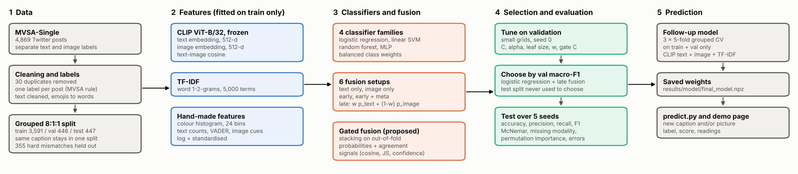

# Methodology

This page explains the steps in preprocessing, training and evaluation. The notebooks hold the full detail and code.

The diagram is drawn by `python scripts/make_architecture_diagram.py`.

## Preprocessing

1. **Missing and broken data.** We checked for invalid labels, missing or empty text, missing or corrupt images, and exact duplicates. The 30 duplicates were the only problem found. Raw text and pixels are never imputed.
2. **Labels.** Matching text and image labels give that label. If one label is neutral, the other is used (a soft mismatch). Positive against negative has no single label (a hard mismatch), so these posts are held out of training.
3. **Text cleaning.** HTML entities are decoded, URLs and retweet prefixes removed, mentions replaced with `@user`, hashtags split into words, emojis converted to words and elongated words shortened. Case, punctuation and stop-words stay, because they can signal sentiment. Standard stop-word lists include "not".
4. **Splitting.** Labelled posts are split 8:1:1 before anything is fitted. The split is stratified on label and agreement group, and identical captions stay in one split, so a retweeted caption can't leak into the test set.
5. **Features.** These are frozen CLIP ViT-B/32 text and image embeddings (512 dimensions each) and their cosine similarity, TF-IDF on word 1-2-grams, an 8-bin colour histogram per channel, and engineered text and image features.
6. **Scaling.** Counts and sizes are log-transformed and standardised, and ratios are standardised, using training-set statistics only. Binary flags stay 0 or 1. Histograms are normalised per channel, and TF-IDF and CLIP vectors to unit length.

## Models

Classical classifiers are trained on frozen CLIP embeddings rather than training deep networks end to end. CLIP has about 150 million parameters, so fine-tuning it on 3,591 noisy posts would risk overfitting. Frozen features also make training cheap enough to repeat over five seeds.

| Classifier | Why it is included | Key settings |
|---|---|---|
| Logistic regression | Standard linear probe for CLIP, with direct probabilities and readable coefficients | Balanced class weights; `C` tuned |
| Linear SVM | Margin-based and robust in high dimensions | Balanced class weights; `C` tuned; Platt scaling for probabilities |
| Random forest | Tests whether tree-based non-linearity helps | Balanced subsample weights; 300 trees; minimum leaf size tuned |
| MLP (256 hidden units) | Tests whether learned text-image interactions help | `alpha` tuned; early stopping; minority classes oversampled |

| Fusion setup | Input |
|---|---|
| Baseline | TF-IDF and colour histogram, with logistic regression |
| Text only / image only | One CLIP embedding |
| Early fusion | Concatenated text and image embeddings |
| Early + meta | Early fusion plus engineered features |
| Late fusion | `w × p_text + (1 − w) × p_image`, with `w` tuned |
| Gated fusion (proposed) | A stacking logistic regression on both sets of probabilities, CLIP cosine similarity, Jensen-Shannon divergence and each classifier's confidence |

The gate trains on 5-fold out-of-fold predictions, which stops it learning from over-confident probabilities on posts the single-modality models have already seen.

## Training protocol

1. Tune hyperparameters on the validation set over small grids, using seed 0.
2. Tune the late-fusion weight and the gate's regularisation on the same set.
3. Retrain each tuned setup over five seeds and report the mean and standard deviation.
4. Choose the final model by validation macro-F1. Test scores are reported but never used to choose.

A follow-up, run after the main results were fixed, compared 120 configurations by 3 x 5-fold grouped cross-validation on the training and validation splits combined, and scored only the winner on the test split. It is reported separately, in [results.md](results.md#follow-up-model).

## Algorithms

The four procedures below are the ones the notebooks and scripts run. They use the same names as the code in `src/mvsa/modeling.py`.

### Algorithm 1: Full pipeline

**Input:** MVSA-Single posts, each with a caption, an image, a text label and an image label.
**Output:** the chosen model and its test scores.

1. Read every caption and image. Drop posts with an invalid label, a missing or corrupt file, or an exact duplicate (same caption and same image bytes).
2. Give each post one label. If the two labels match, use that label. If one is neutral, use the other one. If one is positive and the other negative, mark the post as a hard mismatch and set it aside.
3. Clean the captions (Preprocessing, step 3).
4. Split the labelled posts 8:1:1 into train, validation and test with `StratifiedGroupKFold`. Strata are label and agreement group; groups are the normalised caption.
5. Fit the TF-IDF vocabulary and the feature scaler on the training split, then apply them to every split. Embed every caption and image with frozen CLIP.
6. For each classifier family, tune its settings on the validation split (Algorithm 2).
7. For each family and each seed from 0 to 4, train every fusion setup on the training split, using Algorithm 3 for the gate. Score each one on the validation, test and hard-mismatch posts.
8. Average the scores over the seeds. Choose the family and setup with the highest mean validation macro-F1, leaving out the baseline, which is a reference point.
9. Report the chosen model's test scores, then run the McNemar tests, the missing-modality test, permutation importance and the error analysis.

### Algorithm 2: Tuning on the validation split

**Input:** one classifier family, its small grid, the training and validation splits. Seed 0.
**Output:** the best grid value for each input, the late-fusion weight `w` and the gate's `C`.

1. For each input (text, image, early, early + meta) and each grid value, train on the training split and compute validation macro-F1. Keep the best value for each input.
2. Train the text and image models with their best values. Get their validation probabilities `p_text` and `p_image`.
3. For `w` from 0 to 1 in steps of 0.1, score `w × p_text + (1 − w) × p_image` on validation. Keep the best `w`.
4. Build the gate's training inputs from out-of-fold probabilities (Algorithm 3, steps 1 to 3) and its validation inputs from `p_text` and `p_image`. For `C` in 0.1, 1 and 10, fit the gate and score it on validation. Keep the best `C`.

### Algorithm 3: Training the gated fusion

**Input:** the training split, one family with its tuned settings, and a seed.
**Output:** a gate that turns the two modalities' probabilities into one prediction.

1. Divide the training split into 5 stratified folds.
2. For each fold, train the text model and the image model on the other four folds and predict class probabilities for the held-out fold. Every training post now has probabilities from models that never saw it.
3. For each post, build 10 gate inputs: the 3 text probabilities, the 3 image probabilities, the cosine similarity of the CLIP text and image embeddings, the Jensen-Shannon divergence between the two sets of probabilities, and the highest probability of each model.
4. Standardise the inputs and fit a logistic regression with balanced class weights and the tuned `C`.
5. To predict, train the text and image models on the whole training split, build the same 10 inputs from their probabilities and pass them to the gate.

Step 2 matters. A model scoring posts it was trained on is over-confident, and a gate trained on those scores would learn to trust both modalities more than it should.

### Algorithm 4: Follow-up selection by cross-validation

**Input:** the training and validation splits combined (4,037 posts). The test split is not read.
**Output:** one configuration, then its test score.

1. Make 15 folds: 5-fold `StratifiedGroupKFold` repeated with 3 shuffles. Posts with the same caption stay in one fold.
2. In each fold, fit logistic regression on the text, image, early and early + meta inputs for each `C` from 0.00001 to 0.1, and a TF-IDF word model. Keep their held-out probabilities.
3. Combine the saved probabilities into 120 configurations: early, early + meta, late fusion with `w` of 0.3, 0.5 or 0.7, and the average of the CLIP text, CLIP image and TF-IDF models. Each is tried with the neutral probability multiplied by 0.75, 1, 1.25 or 1.5.
4. Score every configuration by its mean macro-F1 over the 15 folds and choose the highest. This rule was fixed before any result was seen.
5. Train the chosen configuration on the training split and score it once on the test split.

## Evaluation

- **Accuracy:** the share of all posts predicted correctly.
- **Precision:** of the posts predicted as a class, the share that really are in it.
- **Recall:** of the posts really in a class, the share the model found.
- **F1:** the harmonic mean of precision and recall.
- **Macro averages:** give all three classes equal weight. Macro-F1 drives model selection because the neutral class is small.

We also report accuracy per agreement group, which modality the model follows on hard-mismatch posts, a McNemar test between early and gated fusion, and scores with one modality masked by its training-set mean embedding.
