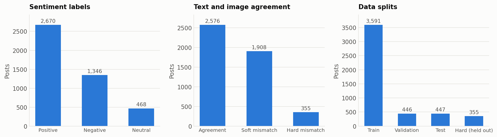
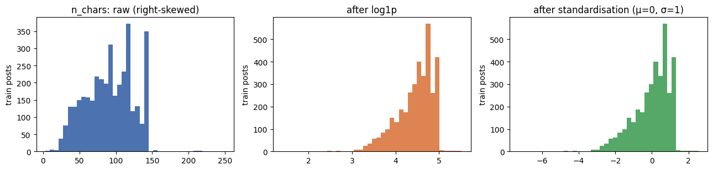
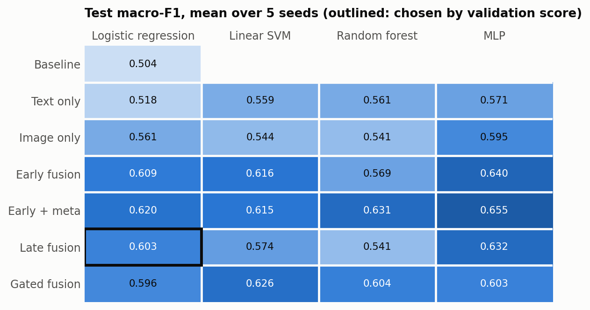
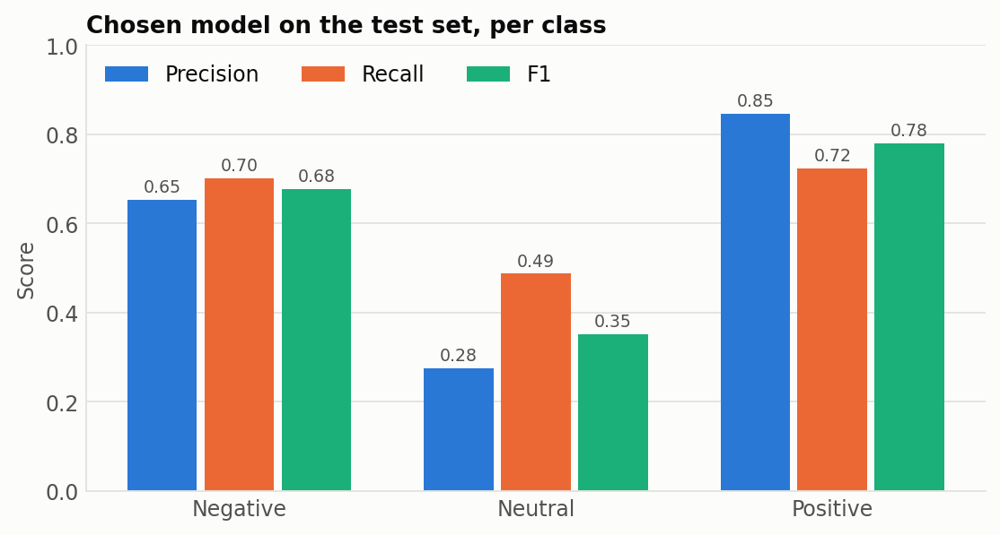
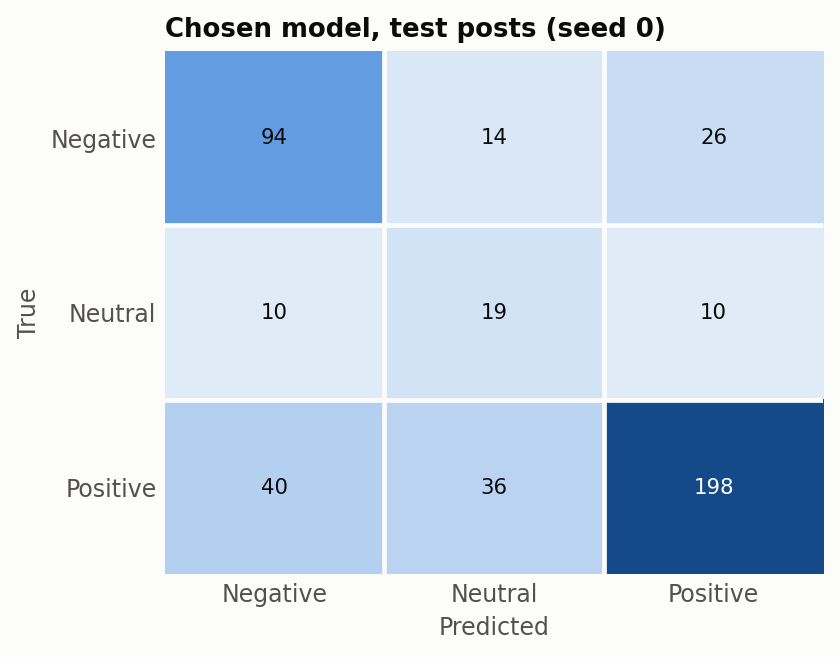
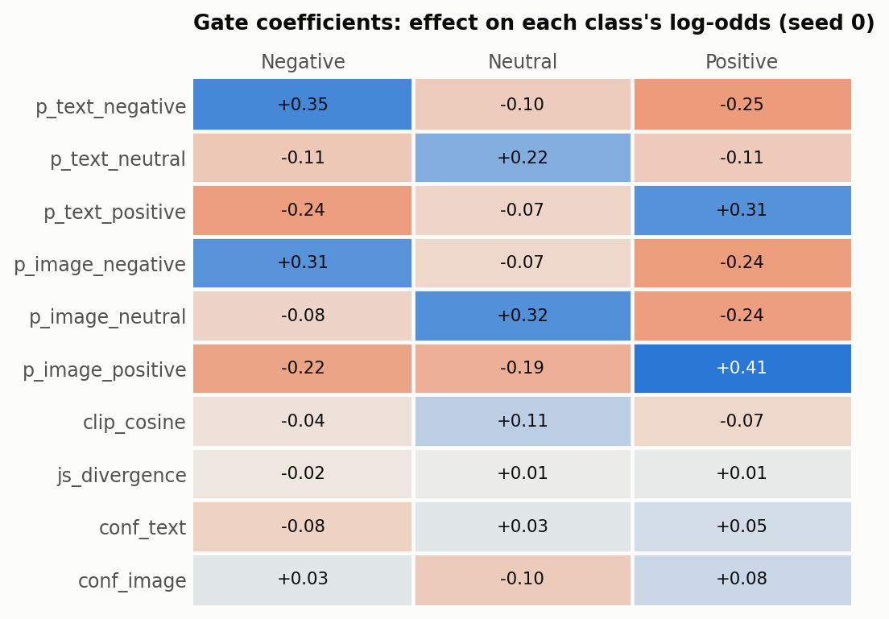
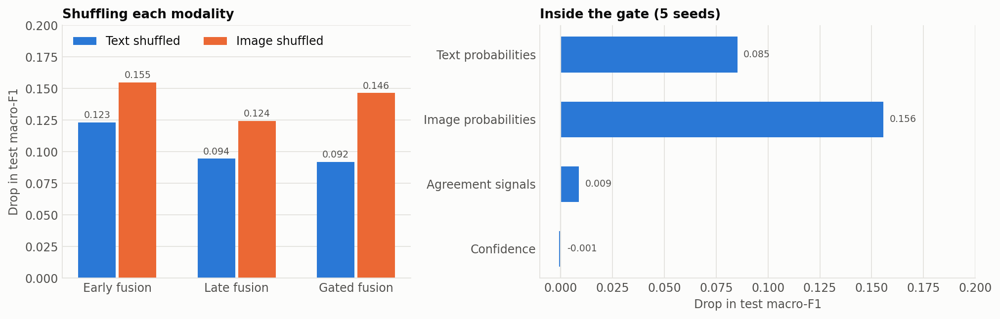
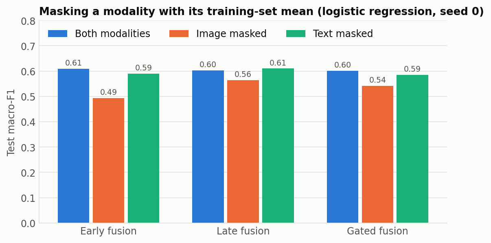
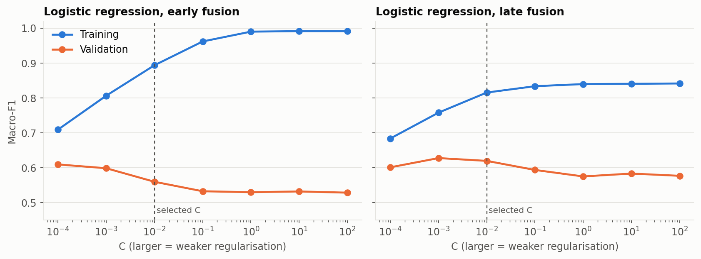

# Results

All numbers come from the full five-seed Kaggle run. The data behind each figure is in `results/metrics/`, and `python scripts/make_figures.py` redraws the figures.

## Dataset

The classes are imbalanced and text and image labels often disagree, on 46.8% of posts.

## Model comparison

Logistic regression with late fusion had the highest validation macro-F1 (0.619) and was selected. It scores 0.603 macro-F1 and 0.696 accuracy on the test set, compared with 0.504 and 0.622 for the baseline.

The MLP with early + meta scored highest on test (0.655), but its validation score was 0.613, so it was not selected. Choosing it on test score would invalidate the test set as an unbiased estimate.

## Per-class results

Neutral is the weak class. The model found 19 of the 39 neutral test posts, but only 19 of its 69 neutral predictions were correct.

## Did gated fusion help?

No. For logistic regression, gated fusion was less accurate than early fusion on both agreeing posts (0.755 vs 0.779) and soft-mismatch posts (0.569 vs 0.639). Compared with early fusion, it lowered macro-precision in all four classifier families and raised macro-recall in three.

| Family | Early only correct | Gated only correct | McNemar p-value |
|---|---|---|---|
| Logistic regression | 38 | 19 | 0.016 |
| Linear SVM | 57 | 31 | 0.007 |
| Random forest | 78 | 60 | 0.148 |
| MLP | 45 | 27 | 0.044 |

The gate relies on the two sets of class probabilities and gives the Jensen-Shannon divergence almost no weight, so it behaves much like an average of the two modalities. These inputs are correlated and the coefficients come from one seed, so this is supporting evidence rather than proof.

## What the predictions rely on

Permutation importance shuffles one input across the test posts and measures how much test macro-F1 drops. A bigger drop means the model relies on that input more.

- **The image matters more than the text** in every fusion setup. For the chosen late-fusion model, shuffling the image cuts macro-F1 by 0.124 and shuffling the text by 0.094.
- **The gate barely uses its agreement signals.** Over five seeds, shuffling the cosine similarity and Jensen-Shannon divergence cuts macro-F1 by only 0.009, and shuffling the confidence values changes nothing (−0.001). The gate relies on the two models' probabilities instead (0.156 for the image and 0.085 for the text). This explains why gated fusion behaved like an average of the two modalities and didn't beat simpler fusion.

## Characteristic errors

The chosen model misclassified 136 of the 447 test posts (30.4%). Its confusion matrix is identical across all five seeds, because logistic regression is deterministic. Gated fusion varies slightly between seeds.

| Group of test posts | Posts | Error rate |
|---|---:|---:|
| All | 447 | 30.4% |
| Separate text and image models agree | 246 | 19.9% |
| Separate text and image models disagree | 201 | 43.3% |
| Score 0.70 or more | 166 | 12.7% |
| Score below 0.45 | 39 | 66.7% |
| Human labels agree | 253 | 24.1% |
| Soft mismatch | 194 | 38.7% |

The most common mistakes are positive posts predicted negative (40) or neutral (36), and negative posts predicted positive (26). Reading the most confident mistakes shows four patterns:

- **Mixed or ironic posts:** for example, a complaint about bad weather paired with a photo of a sunny holiday the writer wishes they were on.
- **Sad wording with a positive label:** quotes about grief or loss that the annotators marked positive.
- **Product listings and adverts:** plain descriptions of items for sale, which the model reads as neutral but annotators often marked positive.
- **Likely label noise:** some posts look neutral or ambiguous to a reader despite their label. MVSA-Single has a single annotator per modality.

The score and the agreement between the two separate models are useful warnings. When the score is below 0.45, two in three predictions are wrong. When the text and image models disagree, the error rate more than doubles.

On hard-mismatch posts, the chosen model's prediction matches the image label 51.0% of the time and the text label 41.1%.

## Neutral and reading each part separately

Neutral is the hardest class partly because of the labelling rule: a post is only neutral when both its text and its image are neutral. 42.7% of training and validation posts have a neutral caption, but only 24.9% of those end up neutral, because an emotional image overrules the caption. Models trained on the combined labels therefore learn that even calm captions are usually positive or negative.

MVSA-Single also labels the text and image separately, so each modality's model can be trained on its own labels, using the same frozen CLIP features and logistic regression. `C = 0.001` was chosen on the validation set, and the test set was then used once. Each model is judged against its own modality's labels:

| Test set | Macro-F1 | Neutral F1 | Neutral precision | Neutral recall |
|---|---:|---:|---:|---:|
| Text model, trained on combined labels | 0.505 | 0.346 | 0.597 | 0.243 |
| **Text model, trained on text labels** | **0.676** | **0.657** | **0.745** | **0.587** |
| Image model, trained on combined labels | 0.596 | 0.430 | 0.416 | 0.446 |
| **Image model, trained on image labels** | **0.622** | **0.492** | **0.422** | **0.590** |

These are a different task from the main results: they measure what each part says on its own, not the post's overall label. The demo shows them alongside the overall prediction, and uses them when only a caption or only a picture is given. A post whose two readings point in opposite directions is flagged as a possible sarcasm or mixed message. Across validation, test and hard-mismatch posts, 51.8% of flagged posts were hard mismatches, against 28.4% of all those posts, and the flag caught 37.2% of hard mismatches.

## Missing modalities

Masking the image hurt macro-F1 in all three fusion setups, while masking the text changed it far less. The mean embedding isn't a neutral input, because it pushes predictions towards the majority class. This test therefore doesn't show how the model would behave with truly missing data.

## Bias-variance trade-off and regularisation

Stronger L2 regularisation narrowed early fusion's train-validation gap from 0.46 to 0.10, showing that its main risk is high variance. At large `C`, it almost memorises the training set (0.991) while validation stays near 0.53.

The chosen `C = 0.01` is the strongest value in the tuning grid. Late fusion reaches 0.627 at `C = 0.001`, compared with 0.619 at the selected value. The reported model keeps the pre-specified grid.

## Limitations

The top validation scores differ by only 0.006 on 446 posts, and no confidence intervals were computed. The McNemar tests, gate coefficients and robustness results each use a single seed.

## Reproducibility

The six notebooks were rerun in order on the full dataset and compared with the results above. The preprocessing counts, the chosen model and its scores, and every logistic regression, linear SVM and random forest score matched exactly.

Only the MLP differed. Its tuned late-fusion weight was 0.3 rather than 0.5, which moved MLP late fusion from 0.632 to 0.618 test macro-F1. Its other macro-F1 scores moved by less than 0.003, and MLP early + meta did not change at 3 decimal places. The bias-variance curve moved by at most 0.003, at `C` of 10 or more.

The code was the same in both runs, but the model training ran on a CPU machine the first time and a GPU machine the second. That is the likely cause, because MLP training can be sensitive to the hardware, though this wasn't tested separately.

## Predicting new posts

`scripts/predict.py` uses the saved final model in `results/model/`. On the test set, that saved model gives the same prediction as the full Kaggle run for all 447 posts, with 0.603 macro-F1 and 0.696 accuracy. Its text-cleaning code also reproduces the cleaned text of all 4,839 posts.

The checks on new text used CLIP on a different machine, whose text embeddings matched the Kaggle ones on the 40 test posts compared. The same comparison wasn't run for images, because the dataset's images weren't available on that machine, so image predictions were only tested for running correctly.

## Where to find each result

| Result | Notebook in `notebooks/02_modeling/` |
|---|---|
| Model comparison, per-class and per-group results | `01_training_and_model_selection.ipynb` |
| McNemar tests, missing modalities, gate coefficients, confusion matrix | `02_significance_and_robustness.ipynb` |
| Bias-variance curve and tuned hyperparameters | `03_bias_variance_and_regularisation.ipynb` |
| Permutation importance, confusion matrices over seeds, error analysis | `04_explanation_and_error_analysis.ipynb` |
